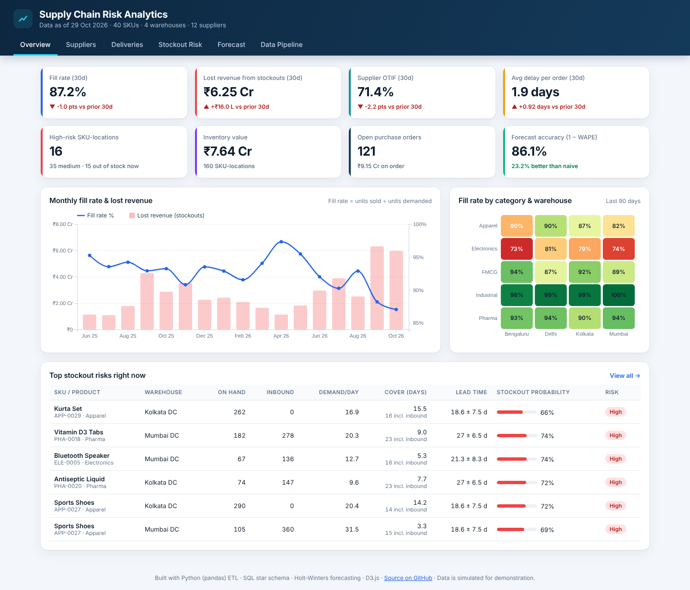
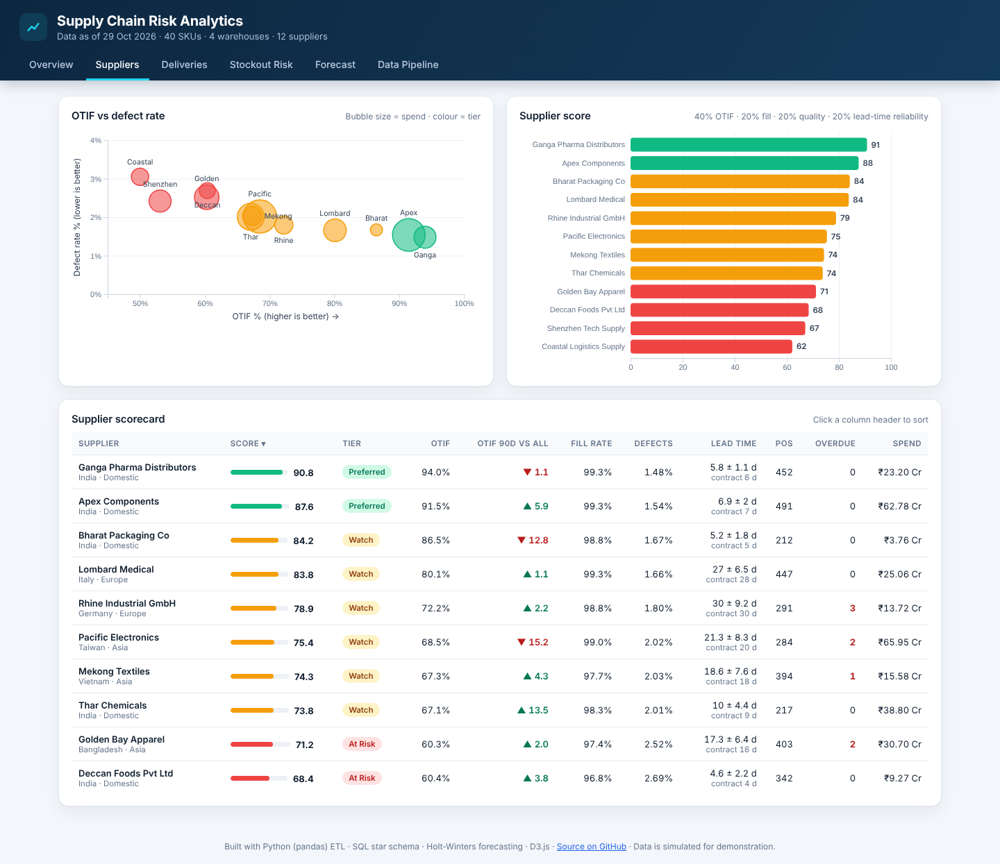
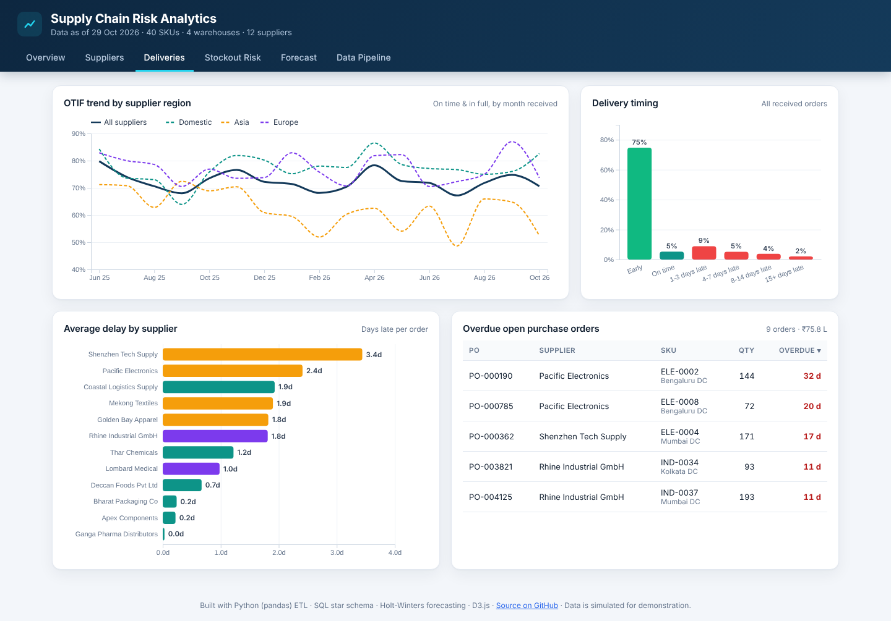
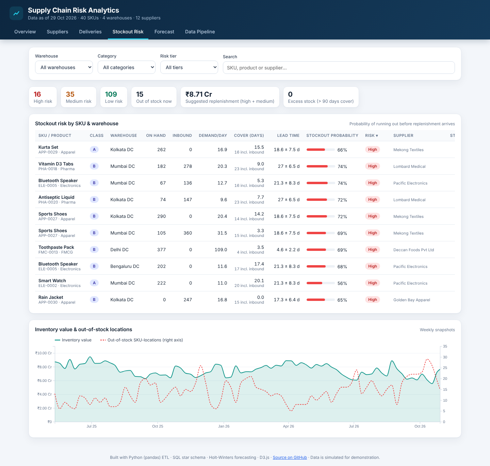
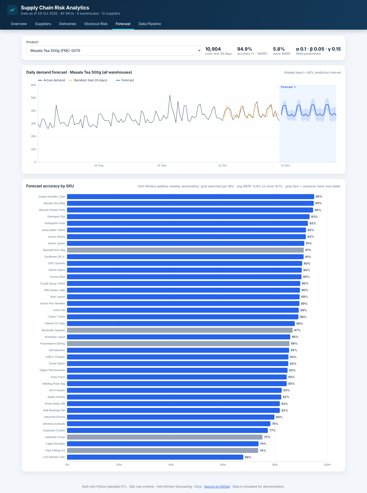
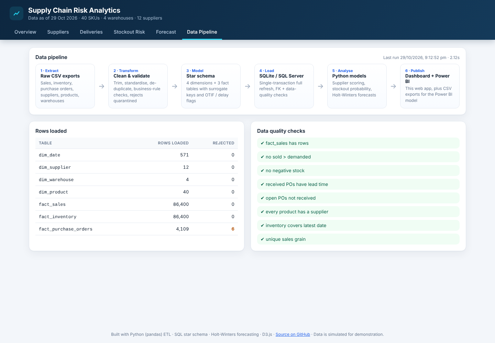
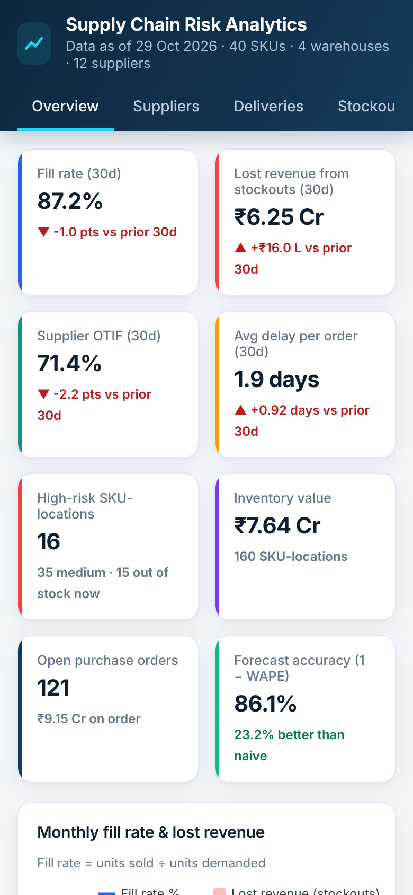

# Supply Chain Risk Analytics

An end-to-end analytics solution that monitors **inventory, supplier performance, delivery delays and stockout risk** across a multi-warehouse supply chain, with **demand forecasting**, an **automated ETL pipeline**, a **SQL star schema**, a live **interactive dashboard**, and a ready-to-build **Power BI** model (DAX + Power Query).

**Live dashboard:** https://supply-chain-risk-analytics.onrender.com



## What it answers

| Question | Where |
|---|---|
| Are we meeting customer demand? Where are we losing sales to stockouts? | Overview: fill rate, lost revenue, category × warehouse heatmap |
| Which suppliers are reliable, and which are a risk? | Suppliers: composite score, OTIF vs defects, lead-time variability |
| How late are deliveries, and which open orders are overdue? | Deliveries: OTIF trend by region, delay distribution, overdue POs |
| Which SKUs will run out before replenishment arrives, and what should we order? | Stockout Risk: probability per SKU-warehouse, suggested order qty |
| What will demand look like over the next 4 weeks? | Forecast: Holt-Winters forecast with 80% interval and backtest accuracy |
| Can we trust the data? | Data Pipeline: rows loaded, duplicates/rejects, data-quality checks |

## Key results (sample run)

- **40 SKUs × 4 warehouses × 12 suppliers**, ~18 months of daily data (86K sales rows, 4K purchase orders)
- Forecasts reach **~86% accuracy (1 − WAPE)**, **~23% more accurate than a seasonal-naive baseline**
- Supplier scorecard flags **4 "At Risk" suppliers**; risk model surfaces the SKU-locations most likely to stock out and the replenishment needed

## Architecture

```
 scripts/generate_data.py          pipeline/ (ETL)                         analytics/              site/ (D3.js dashboard)
 ┌──────────────────────┐   ┌──────────┐  ┌────────────┐  ┌──────────┐   ┌──────────────────┐   ┌─────────────────────┐
 │ Simulated ERP/WMS    │──▶│ Extract  │─▶│ Transform  │─▶│  Load    │──▶│ SQL queries +    │──▶│ dashboard.json      │
 │ exports (CSV)        │   │ (typed)  │  │ clean,     │  │ SQLite   │   │ supplier scoring │   │ → interactive web   │
 │ sales, inventory,    │   └──────────┘  │ validate,  │  │ star     │   │ stockout risk    │   │   dashboard         │
 │ POs, master data     │                 │ model      │  │ schema   │   │ Holt-Winters     │   └─────────────────────┘
 └──────────────────────┘                 └────────────┘  └────┬─────┘   └──────────────────┘   ┌─────────────────────┐
                                                               └──────── exports/*.csv ────────▶│ Power BI (DAX + M)  │
                                                                         sql/schema_sqlserver   └─────────────────────┘
```

**Automation:** a GitHub Action runs daily (tests → generate → ETL → analytics) and commits the refreshed data, which redeploys the live dashboard on Render.

## Tech stack

| Area | Tools |
|---|---|
| ETL & analytics | Python, pandas, NumPy |
| Data model | SQL star schema: SQLite (pipeline) and SQL Server DDL, indexes and reporting views |
| Forecasting | Holt-Winters triple exponential smoothing (implemented from scratch), grid-searched per SKU, backtested |
| Risk modelling | Lead-time demand distribution, safety stock and reorder point by service level (ABC class) |
| BI | Power BI: DAX measures, Power Query (M) scripts, model and report guide |
| Dashboard | HTML/CSS/JavaScript + D3.js (no framework) |
| DevOps | GitHub Actions (CI + daily refresh), Render (static hosting) |

## Data model

Star schema with surrogate keys: `dim_date`, `dim_supplier`, `dim_warehouse`, `dim_product` and three facts:

- `fact_sales`: daily units demanded / sold / lost and revenue by SKU and warehouse
- `fact_inventory`: daily on-hand stock and value
- `fact_purchase_orders`: order, promised and received dates, quantities, defects, lead time, delay, **on-time / in-full / OTIF flags**

Reporting views: `vw_supplier_scorecard`, `vw_monthly_delivery`, `vw_latest_inventory`. See [`sql/`](sql).

## How the analytics work

**Supplier score (0–100)** = 40% OTIF + 20% fill rate + 20% quality (defects) + 20% lead-time reliability (1 − CV).
Tiers: Preferred ≥ 85, Watch ≥ 72, otherwise At Risk.

**Stockout risk.** For each SKU-warehouse, demand over the supplier's lead time is modelled as
`Normal(μ·L, √(L·σ² + μ²·σ_L²))` using the last 56 days of unconstrained demand and actual received-PO lead times.
Stockout probability = P(lead-time demand > on hand + inbound). Safety stock and reorder point use the service level of the
product's ABC class (A 98%, B 95%, C 90%); the suggested order brings stock up to the reorder point plus a 14-day review period.

**Forecasting.** Additive Holt-Winters with weekly seasonality on daily unconstrained demand (so stockouts don't bias it
downward). Parameters are grid-searched per SKU, evaluated on a 28-day holdout with WAPE against a seasonal-naive baseline,
then refit on all data for a 28-day forecast with an 80% prediction interval.

**Data quality.** The ETL removes duplicates, standardises text, validates business rules (e.g. received ≤ ordered,
receipt after order date) and quarantines bad rows in `data/rejects/` with a reason. Post-load checks
(FK integrity, grain uniqueness, no negative stock and more) must pass before the dashboard is published.

## Run it locally

```bash
git clone https://github.com/shivesh122/supply-chain-risk-analytics.git
cd supply-chain-risk-analytics
pip install -r requirements.txt

python build_dashboard.py --refresh      # generate data → ETL → analytics → site/data/dashboard.json
python -m http.server 8000 --directory site
# open http://localhost:8000
```

Other commands:

```bash
python scripts/generate_data.py --as-of 2026-10-29   # regenerate source data for a given date
python -m pipeline.run_etl                           # ETL only
python -m unittest discover -s tests -t .            # unit tests
```

Query the warehouse directly with any SQLite client: `data/warehouse/supply_chain.db` (examples in `sql/analysis_queries.sql`).

## Power BI

Everything needed to build the Power BI report is in [`powerbi/`](powerbi):
[`power_query.m`](powerbi/power_query.m) (load + typing), [`dax_measures.dax`](powerbi/dax_measures.dax) (fill rate, OTIF,
supplier score, days of cover, time-intelligence comparisons…) and [`POWERBI_GUIDE.md`](powerbi/POWERBI_GUIDE.md)
(relationships, pages and visuals).

## Screenshots

| Suppliers | Deliveries |
|---|---|
|  |  |

| Stockout risk | Forecast |
|---|---|
|  |  |

| Data pipeline | Mobile |
|---|---|
|  |  |

## Project structure

```
├── scripts/generate_data.py   # supply-chain simulation (demand, stock, POs, supplier behaviour)
├── pipeline/                  # extract.py, transform.py, load.py, quality.py, run_etl.py
├── analytics/                 # kpis, suppliers, delivery, inventory_risk, forecasting
├── sql/                       # SQLite + SQL Server schemas, analysis queries
├── powerbi/                   # DAX measures, Power Query scripts, report guide
├── site/                      # dashboard (index.html, app.js, styles.css, data/dashboard.json)
├── exports/                   # star schema as CSV (Power BI source)
├── tests/                     # unit tests
├── build_dashboard.py         # end-to-end build
└── .github/workflows/         # CI + daily refresh
```

## About the data

The data is **simulated** by `scripts/generate_data.py`: realistic demand patterns (trend, weekly and yearly seasonality,
promotions), an (s, S) replenishment policy, and supplier-specific lead-time variability, disruptions, short shipments and
defects, with deliberately dirty records for the ETL to clean. The same pipeline works on real ERP/WMS exports with the
same columns.

## License

MIT © Shivesh Tiwari
